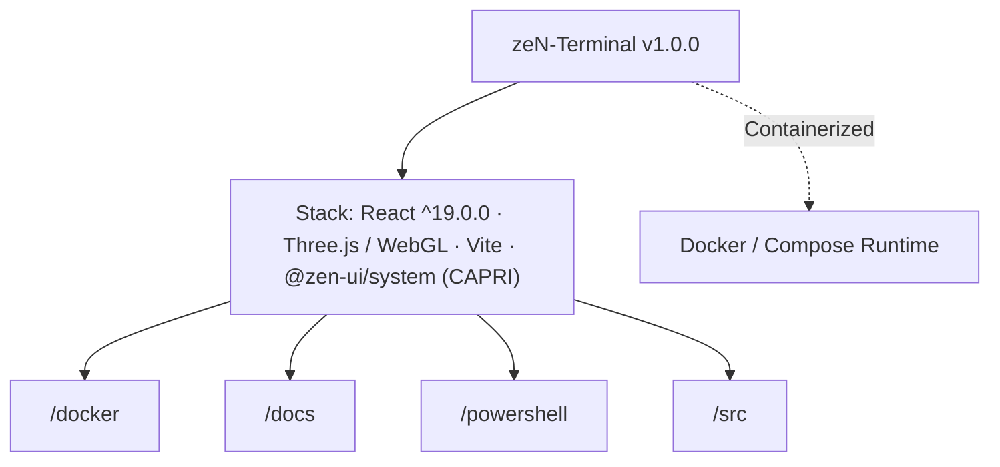

# zeN-Terminal // CAPRI Automated Architecture & AI Context Dossier
> Generated on demand via `npx capri docu` (Zero build or browser runtime overhead)

## 1. Project Identity & Stack Overview
- **Repository:** `zeN-Terminal` (`zen-terminal`)
- **Version:** `1.0.0`
- **Detected Stack:** React ^19.0.0 · Three.js / WebGL · Vite · @zen-ui/system (CAPRI) · TypeScript · PowerShell · Docker Containerized
- **Top-Level Subsystems:** `/docker`, `/docs`, `/powershell`, `/src`
- **Container Readiness:** `docker-compose.yml` present

## 2. Codebase Metrics & Language Breakdown
- **Total Source Files Scanned:** 8
- **Total Lines of Code (LOC):** 1,404
- **File Extensions:** `.ps1` (3), `.tsx` (2), `.html` (1), `.css` (1), `.ts` (1)
- **Key Exported Symbols / Classes / Functions (1):** `TerminalLogEntry`

## 3. Architecture & Subsystem Topology (`flowchart TD`)

## 4. Largest Modules & Entrypoints Inventory
| Module Path | Lines | Extension |
| :--- | ---: | :--- |
| `src/App.tsx` | 771 | `.tsx` |
| `powershell/zen-profile.ps1` | 356 | `.ps1` |
| `powershell/install-zen-terminal.ps1` | 167 | `.ps1` |
| `powershell/uninstall-zen-terminal.ps1` | 46 | `.ps1` |
| `src/index.css` | 21 | `.css` |
| `index.html` | 19 | `.html` |
| `src/main.tsx` | 15 | `.tsx` |
| `vite.config.ts` | 9 | `.ts` |

## 6. Available Build & Automation Scripts
- `npm run dev`: `vite --port 5185`
- `npm run build`: `tsc -b && vite build`
- `npm run preview`: `vite preview`
- `npm run install:terminal`: `powershell -ExecutionPolicy Bypass -File ./powershell/install-zen-terminal.ps1`

## 7. Capri AI Agent Protocol (Claude / Codex / Gemini / Antigravity)
- **Subroutine `orion` (`CAPRI // UNLEASHED`):** Use `@zen-ui/system` primitives and `<ZenIcon>` (40 vector glyphs) for UI views; keep action labels concise (`1-3 words`).
- **Subroutine `architect` (`SCS // ARCHITECT`):** Enforce strict typing (zero `any`, `readonly T[]`), modular files (`< 900` lines), and `--zen-*` CSS tokens.
- **Subroutine `guard` (`CYBERPSYCHOSIS // GUARD`):** Sanitize untrusted inputs (`capri.sanitizeForPrompt()`), prevent XSS/secret leaks, bind dropdowns to `onMouseDown`, and ensure zero horizontal overflow (`320px` to `4K`).
- **Subroutine `zen` (`THEME // MATRIX`):** Maintain 4 Dark + 4 Light themes (`>= 4.5:1` AA contrast) and 60fps `--zen-ease-spring` tactile motion.
- **Subroutine `docu` (`CAPRI // AUTO-DOCU`):** Re-run `npx capri docu --write` whenever architectural boundaries or modules change.
